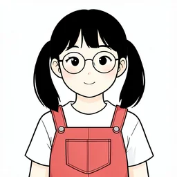
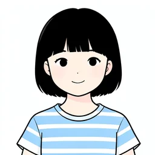
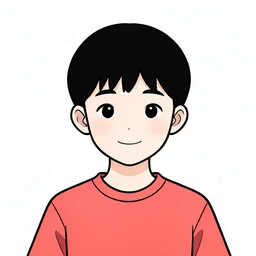
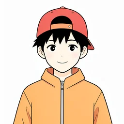
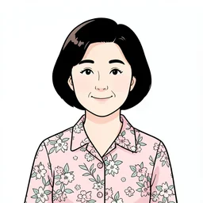

# 기본 화자 24명

카드 화자에 붙일 수 있는 기본 그림이에요. 형식과 쓰는 법은 [화자 그림](../../spec/characters.md#2-기본-화자)에 있어요.

- 백엔드: 처음 한 번 `<id>.png`·`<id>_thumb.webp`를 MinIO에 올리고 `characters.json`을 테이블에 넣어요(시드 데이터)
- `<id>.png`(768×768)는 워커가 참조로 받는 원본, `<id>_thumb.webp`(256×256)는 앱 팝업용이에요
- `appearance`는 그림 모델용 영어 외모 글이라 앱에는 보이지 않아요
- 2호 젯슨에서 만화와 같은 FLUX.2 klein 4B·같은 화풍 문장으로 만들었어요(한 명당 후보 3장 중 1장, `seed`가 고른 시드)

| 그림 | id | 나이대 | 성별 | 안경 | label |
| --- | --- | --- | --- | --- | --- |
|  | `kid-f-01` | 어린이 | 여 |  | 분홍 머리띠 긴 생머리 소녀 |
|  | `kid-f-02` | 어린이 | 여 | O | 동그란 안경 양갈래 소녀 |
|  | `kid-f-03` | 어린이 | 여 |  | 앞머리 단발 소녀 |
|  | `kid-f-04` | 어린이 | 여 | O | 보라 안경 곱슬 포니테일 소녀 |
|  | `kid-m-01` | 어린이 | 남 |  | 까까머리 소년 |
|  | `kid-m-02` | 어린이 | 남 | O | 동그란 안경 바가지 머리 소년 |
|  | `kid-m-03` | 어린이 | 남 |  | 야구모자 소년 |
|  | `kid-m-04` | 어린이 | 남 | O | 사각 안경 가르마 소년 |
|  | `young-f-01` | 청년 | 여 |  | 긴 웨이브 머리 청년 여성 |
|  | `young-f-02` | 청년 | 여 | O | 금테 안경 단발 청년 여성 |
|  | `young-f-03` | 청년 | 여 |  | 포니테일 청재킷 청년 여성 |
|  | `young-f-04` | 청년 | 여 | O | 뿔테 안경 애쉬 머리 청년 여성 |
|  | `young-m-01` | 청년 | 남 |  | 투블럭 청년 남성 |
|  | `young-m-02` | 청년 | 남 | O | 뿔테 안경 곱슬 파마 청년 남성 |
|  | `young-m-03` | 청년 | 남 |  | 헤어밴드 운동복 청년 남성 |
|  | `young-m-04` | 청년 | 남 | O | 사각 안경 가르마 청년 남성 |
|  | `middle-f-01` | 중장년 | 여 |  | 파마머리 중년 여성 |
|  | `middle-f-02` | 중장년 | 여 | O | 돋보기 안경 회색 단발 중년 여성 |
|  | `middle-f-03` | 중장년 | 여 |  | 앞치마 쪽머리 중년 여성 |
|  | `middle-f-04` | 중장년 | 여 | O | 빨간 안경 정장 중년 여성 |
|  | `middle-m-01` | 중장년 | 남 |  | 콧수염 중년 남성 |
|  | `middle-m-02` | 중장년 | 남 | O | 금테 안경 회색 머리 중년 남성 |
|  | `middle-m-03` | 중장년 | 남 |  | 민머리 등산복 중년 남성 |
|  | `middle-m-04` | 중장년 | 남 | O | 뿔테 안경 넥타이 중년 남성 |
